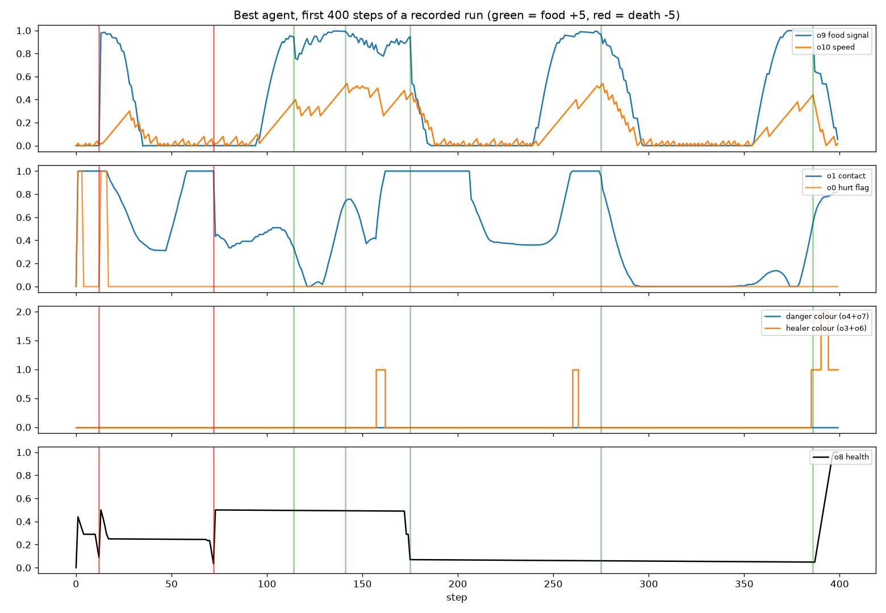
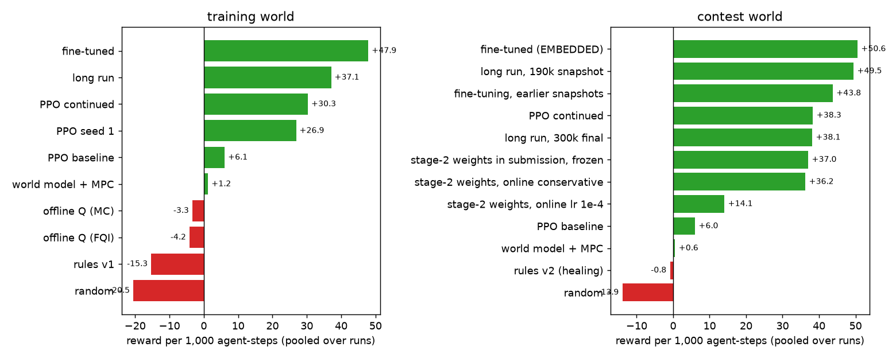

# Reinforcement learning in a black-box multi-agent world

Agent for the **CSC_53439_EP** reinforcement-learning challenge (École polytechnique, October 2026).
The world runs on the organisers' server and is played over the network with
[`pzclient`](https://github.com/jeremiedecock/pettingzoo-client) through the
[PettingZoo](https://pettingzoo.farama.org/) parallel API. It is treated as a **black box**: everything the agent knows
comes from its observations and rewards.

**Final submission:** [`prakhar.tiwari.py`](prakhar.tiwari.py), a single self-contained file. It plays a Double DQN
policy trained against other policies ("co-player 143k"), with an anti-stall rule, and the weights are embedded.

| | Reward per 1,000 steps |
|---|---:|
| Random actions | −14 |
| Our agent, contest world before other participants joined (16–17 Oct) | **+148** |
| Our agent, crowded contest world (21 Oct, 124,595 steps) | **+39.4** |

---

## 1. The challenge

| | |
|---|---|
| **Observation** | 11 numbers `o0 … o10`, declared `Box(0, 1, (11,))`. The world is partially observable. |
| **Action** | `MultiBinary(2)`: 4 joint actions `[0,0] [0,1] [1,0] [1,1]` |
| **Reward** | only three values: `r = +5`, `0`, `r = −5`. Every `r = −5` comes with `infos["died"] = True`, after which the agent reappears; the episode never ends. |
| **Score used in this repository** | reward per 1,000 steps of one agent = 5 × (number of `r = +5` − number of `died`) per 1,000 steps |
| **Training mode** | a private world with 4 agents that waits for our actions |
| **Contest mode** | one shared world with the other participants; it plays a step at most every 5 s whether or not we answer. Official contest: 19–21 Oct 2026. |
| **Rules** | The **policy** network may have at most 128 hidden units; critics used only for learning may be larger. The same program must handle any flat space (Box / Discrete / MultiBinary). One program per token per server. |

## 2. Approach

The work followed five steps. Each step was decided by measurements from the previous one.

1. **Explore before learning.** We recorded random and scripted play (about 1.2M agent-steps) and asked which inputs
   announce the two reward events, and how early:
   - `o9` rises from ≈ 0.13 to ≈ 0.91 over the 20 steps before `r = +5`. Alone, it predicts "`r = +5` within
     10 steps" with AUC 0.93.
   - `o1` rises from ≈ 0.43 to ≈ 0.96 before `died`.

   These 10–20-step lead times fixed the design used by every later model:
   - a 4-observation history plus the previous action as input, so the trend of `o9` is visible;
   - 5-step returns and γ = 0.99;
   - **potential-based reward shaping**, `Φ = 0.5·o9 − 0.5·o1·max(o4, o7) + o8`. It gives a signal before the events
     without changing which policy is best.
2. **Find a learner that reaches `r = +5`.** Hand-written rules, offline Q-learning, and a world model with planning
   all lowered `died` but almost never reached `r = +5`. We then compared PPO (on-policy) with Double DQN (off-policy,
   1M-transition replay buffer pre-filled with all recordings). DDQN won by about 3×.
3. **Choose checkpoints by playing them in the contest world.** Training scores repeatedly ranked checkpoints
   differently from the contest.
4. **Adapt to the crowded contest.** On 20 Oct the score fell from about +148 to about +35. We diagnosed it from
   recorded live play and tested three remedies live. Co-player training plus an anti-stall rule was the one that
   helped.
5. **Make the submission robust:**
   - one file, weights embedded, loads on CPU;
   - reconnects after server errors;
   - a generic PPO learner for any other space.



*400 recorded steps (16 Oct). Green lines: `r = +5`; red lines: `died`. `o9` (top, blue) rises before each `r = +5`;
`o1` (second panel) is at 1 before each `died`. The panel labels are working names from that time.*

## 3. Experiments

Reward per 1,000 steps, frozen policies unless stated. "Training" = the 4-agent training world; "contest" = the shared
contest world. Details for each row are in [`docs/`](docs/).

| # | Date | Experiment | Setup | Result | Conclusion |
|---|---|---|---|---|---|
| 1 | 9–10 Oct | Fixed and random play | random, held-random, each action held constant | −18 to −115 (training) | baseline: random play loses |
| 2 | 10–15 Oct | Exploration of the world | statistics, lead times, probe networks, input importance | `o9` / `o1` announce `r = +5` / `died` 10–20 steps ahead | sets inputs, returns, shaping |
| 3 | 15 Oct | Hand-written rules | move toward high `o9`, avoid high `o1` | −15.3 (training), −0.8 (contest) | fewer `died`, almost no `r = +5` |
| 4 | 15 Oct | Offline Q-learning on recordings | Monte-Carlo and fitted Q-iteration | −3.3 / −4.2 (training) | data from other policies misleads it |
| 5 | 15–16 Oct | World model + planning (MPC) | learned one-step model, short look-ahead | +1.2 (training), +0.6 (contest) | same problem as #4 |
| 6 | 10–16 Oct | **PPO**, 4 stages | policy 64(+64), critic 64–256, shaping, 4-observation history | training +40 to +48; contest **+50.6** | first agent clearly above random |
| 7 | 16 Oct | PPO learning online in the contest | same weights, keep learning while playing | +14.1 (lr 1e-4), +36.2 (conservative) vs +37.0 frozen | online learning did not help |
| 8 | 16 Oct | **Double DQN** | dueling 46→64→64→4, n = 5, 1M pre-filled buffer, ε held 1–8 steps | contest +90 (208k) → +141 (410k) → **+148 (500k)** | 3× PPO; turns back toward a source it passes |
| 9 | 17 Oct | Weight averaging (450k–500k) | mean of 4 checkpoints | +146.4 vs +148 | no gain |
| 10 | 17 Oct | Gentle fine-tune of 500k | lr 3e-5, ε 0.02 → 0.005 | +148.7 (30k), +153.7 (82k), +132.5 (51k) | within noise |
| 11 | 17 Oct | 8-observation history + 10-step returns | widened input (zero weights for new inputs) | +147.4; `died` 1.07 vs 1.96 | fewer `died`, fewer `r = +5` |
| 12 | 20 Oct | Diagnosis of the crowded contest | same policy, live vs training, recorded | live +35 vs training +135; `r = +5` after high `o9`: 20% vs 42% | other agents reach the sources first |
| 13 | 20 Oct | Fine-tune on recorded live data (offline) | unconstrained / anchored to the start weights | +16 to +28 / +31.7 | data from greedy play only: learns to avoid the high-`o9` situations |
| 14 | 20 Oct | **Co-player training** | 2 of 4 agents play other policies from a pool, from 500k | checkpoint 143k: **+39.3** live (150k steps); `died` 2.8 vs 4.2 | helps in the crowd |
| 15 | 20 Oct | Phased co-player run, `died` counted −10 in learning | pool changes every 100k steps; 500k steps | +8.8 to +38.0 live | more freezing; no gain |
| 16 | 20 Oct | Freezing analysis + **anti-stall rule** | bad checkpoints repeat `[0,0]` with `o1 = 1` for up to 3,416 steps | frozen time 8% → 1%; +44.0 → +45.0 (143k), +38.0 → +43.7 (other) | keep the rule |
| 17 | 20–21 Oct | DDQN learning online in the contest | from 143k, 3% exploration, revert safeguard | +33.9 over 156k steps | below frozen 143k |
| 18 | 21 Oct | **Final run of the submission** | 143k + anti-stall, 4 hours | **+39.4** over 124,595 steps, 0 missed actions | submitted |
| 19 | 22–23 Oct | **SAC-Discrete** (after the contest) | actor 64+64, two 256+256 critics, same inputs and buffer | greedy **+145.8** (training) vs DDQN +134.5; offline on DDQN's buffer +139.4; with CQL +59.0 | best in training; never played live |



*Methods compared on 16 Oct, before DDQN (rows 3–7). Reward per 1,000 agent-steps, pooled over runs.*

## 4. Results

| Policy | Training world | Contest, quiet (16–17 Oct) | Contest, crowded (20–21 Oct) |
|---|---:|---:|---:|
| Random actions | −18 | −14 | – |
| PPO (best) | +40 to +48 | +50.6 | – |
| DDQN 500k (3 copies of itself) | +135 (greedy) | **+148** (280k steps) | +35.1 (85k steps) |
| **DDQN co-player 143k + anti-stall (submitted)** | +120 to +130 | – | **+39.4** (124,595 steps) |
| SAC-Discrete, best checkpoint | **+145.8** (greedy) | not tested | not tested |

What the numbers show:

1. **Off-policy learning with replay was the biggest step**: DDQN reached three times PPO's contest score. It reused
   every recorded transition many times. When `o9` is high and starts to fall, it turns back with `[1,0]`
   (62% of those steps), and the gap between two `r = +5` fell from 99 to 33 steps.
2. **The crowd changed the problem, not the rules.** On 20 Oct the same policy still scored +135 in the training
   world but +35 live:
   - it was near high `o9` as often as before, but `r = +5` followed half as often;
   - `died` doubled;
   - contact situations (`o1 = 1` with `o4 = 1`) were 3.5× more frequent.
3. **Training against other policies prepares for other agents.** Co-player training cut `died` by a third at the
   same `r = +5` rate.
4. **Greedy policies can freeze.**
   - Standing still in a contact situation keeps the observation identical, so the greedy choice repeats.
   - Training hides it (1–2% random actions break the loop); live play does not.
   - The anti-stall rule removes most of it.
5. **Training scores do not rank checkpoints reliably.** Checkpoints with similar training scores (+125 to +140)
   ranged from +9 to +43 live.
6. **Offline learning works only on good data.** SAC learned from DDQN's buffer scored +139 in training, but the
   same idea on greedy live data (row 13) or on random data (row 4) failed.

## 5. The submitted agent

[`prakhar.tiwari.py`](prakhar.tiwari.py), one file with no project imports:

- **Contest world** (`Box(11)` → `MultiBinary(2)`):
  - Network: dueling Double DQN. Input = last 4 observations + previous action (46 numbers) → 64 → 64 → 4 Q-values
    (128 hidden units), played greedily.
  - Weights: 500,000 steps with 3 copies of itself, then 143,360 steps with co-players. They are embedded as text
    (zlib + base64) and loaded on CPU.
  - **Anti-stall:** after 10 identical observations while choosing `[0,0]`, play the best moving action (by Q) for
    5 steps.
- **Any other world:** a PPO actor-critic (policy 64+64, critic 256+256) that learns from scratch for any Box /
  Discrete / MultiBinary observation and Discrete / MultiBinary / Box action space.
  [`tests/test_generic.py`](tests/test_generic.py) checks it on CartPole, FrozenLake, Pendulum and two MultiBinary
  tasks.
- **Robust loop:**
  - retries until the server answers;
  - waits out temporary errors (unreachable, disconnected, 408/429/5xx) and rejoins;
  - stops only on a rejected token.

```bash
python prakhar.tiwari.py                    # contest world, 50,000 steps (token from PETTINGZOO_TOKEN or .env)
python prakhar.tiwari.py --steps 20000      # another length
python prakhar.tiwari.py --anti-stall 0     # without the anti-stall rule
python prakhar.tiwari.py --mode training --steps 100000 --save my.pt   # learn in the training world
```

## 6. Repository layout

```
prakhar.tiwari.py        final submission (single file, weights embedded)
pyproject.toml, uv.lock  environment (uv); .env.example: copy to .env and add the token (.env is never committed)
models/                  the submitted policy, the DDQN 500k it started from, the best SAC checkpoint (+ README)
src/explore/             exploration: data collection, statistics, lead times, probes, offline Q, world model, plots
src/train/               learners: ddqn.py, train.py (PPO), sac_discrete.py, sac_offline.py, ddqn_contest_online.py,
                         ddqn_live_ft.py; checkpoint selection and live A/B testing (live_ab.sh, pool_compare.py)
src/contest_record.py    contest player that records every step;  src/build_submission.py  embeds a checkpoint
scripts/                 rl.sh (job launcher) and bg_*.sh (detached long runs on the course machine)
tests/test_generic.py    generality tests on local Gymnasium environments
results/                 text outputs behind the numbers above (pooled tables, analyses, training logs)
docs/                    reports, in reading order in docs/README.md
```

Not included: recordings (`data/`, 26 MB), training runs and replay buffers (`runs/`, ≈ 2 GB), intermediate
checkpoints, and the course slides.

## 7. Running

```bash
uv sync                                   # environment from pyproject.toml / uv.lock
cp .env.example .env                      # then add your PETTINGZOO_TOKEN
uv run python src/check_connection.py     # smoke test on the training server
uv run python prakhar.tiwari.py           # play the contest world
uv run python tests/test_generic.py       # generality tests
```

Training (training server, one program per token):

```bash
uv run python src/train/ddqn.py --name ddqn --total-steps 500000            # DDQN from scratch
uv run python src/train/ddqn.py --name coplay --init models/FINAL_ddqn_500k.pt --prefill false \
    --buffer-from runs/ddqn/buffer.npz --n-learners 2 \
    --coplayers self,models/FINAL_ddqn_500k.pt,random,sticky             # co-player training
uv run python src/train/sac_discrete.py --name sac --total-steps 200000     # SAC-Discrete
uv run python src/build_submission.py models/<checkpoint>.pt                 # embed a policy into prakhar.tiwari.py
```

Machine-specific settings:
- `scripts/*.sh` contain absolute paths of the course machine.
- `pyproject.toml` sets a uv cache directory and the CUDA 13.0 PyTorch index.

Adapt them before use; the code falls back to CPU.

## 8. Documentation

Reading guide: [`docs/README.md`](docs/README.md). Main reports:

- [`docs/EXPLORATION_REPORT_2.md`](docs/EXPLORATION_REPORT_2.md): the world's statistics;
- [`docs/DDQN.md`](docs/DDQN.md): the DDQN and why it beat PPO;
- [`docs/EXPERIMENTS_17OCT.md`](docs/EXPERIMENTS_17OCT.md): pre-contest improvement attempts;
- [`docs/CONTEST_LIVE.md`](docs/CONTEST_LIVE.md): the crowded contest, co-player training, anti-stall;
- [`docs/SAC.md`](docs/SAC.md): SAC-Discrete;
- [`docs/PRESENTATION_NOTES.md`](docs/PRESENTATION_NOTES.md): a 6-slide summary and a PPO / DDQN / SAC comparison.
