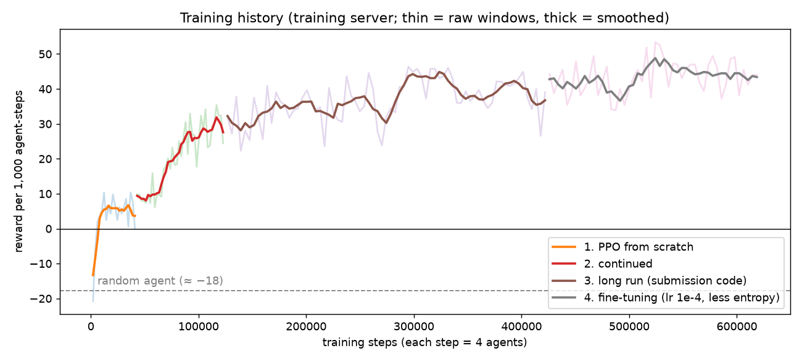
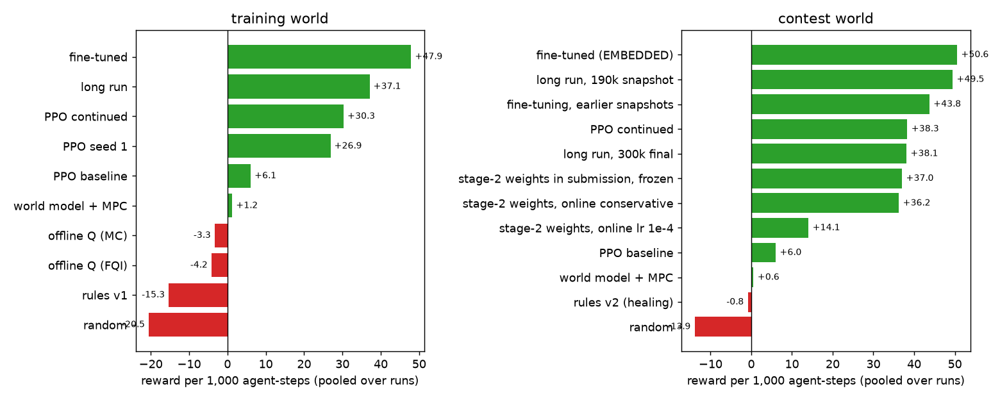

# The final agent: `prakhar.tiwari.py`

> **Status update (17 Oct 2026):** the contest policy embedded in `prakhar.tiwari.py` is now a **Double DQN** (+141 per 1,000 in the contest world vs +51 for the PPO described here). See [STATUS.md](STATUS.md) and [DDQN.md](DDQN.md). The generic parts below (spaces, contest loop, PPO learner for other environments) are still valid.


*What it is, every design decision and why, how well it does, and how to use it. Written for a reader who knows the course but not the code. Last update: 16 October 2026.*

---

## 1. In one paragraph

`prakhar.tiwari.py` is **one self-contained Python file**. It contains a small neural-network agent: two networks of 64 units each, **128 hidden units in total**. The agent learns by trial and error with **PPO**, the policy-gradient method from the course. It reads the observation and action spaces of whatever environment it is connected to and **adapts its input and output layers to them**, so the same code runs on Box, Discrete and MultiBinary spaces. For the contest world it starts from **weights we trained beforehand in the training mode**, which are stored inside the file as text. It can optionally keep learning while it plays. It connects to the contest with a **robust loop** that survives disconnections and server restarts, and it always decides in well under a second (the clock gives 5 s).

---

## 2. How to use it

```bash
# Contest (default): join the shared world and play with the embedded pre-trained weights.
export PETTINGZOO_TOKEN=<your token>            # or keep it in .env (loaded automatically)
python prakhar.tiwari.py --no-learn              # recommended: frozen pre-trained policy
python prakhar.tiwari.py                         # same, but keeps learning (PPO, lr 1e-4)

# Training mode: train all 4 agents of your own world, save the weights.
python prakhar.tiwari.py --mode training --steps 100000 --save data/my.pt
python prakhar.tiwari.py --mode training --load data/my.pt --steps 100000 --save data/my2.pt

# Embed a trained checkpoint into the file (before uploading it to Moodle):
uv run python src/build_submission.py data/my2.pt
```

Useful options: `--steps N` (bound the loop), `--save path` (save the learned weights every few minutes), `--load path` (start from a checkpoint instead of the embedded weights), `--scratch` (ignore the embedded weights), `--lr`, `--rollout`, `--epochs` (online-learning settings).

The token is **never** written in the file. It comes from the `PETTINGZOO_TOKEN` environment variable, as the professor recommends.

---

## 3. Design decisions, and why

Each decision is listed with **what** we chose, **why**, and **the evidence** for it.

### D1. Learning method: PPO (policy gradient, actor-critic)

- **What:** PPO, the clipped policy-gradient method from deck 2. An *actor* network chooses actions and a *critic* network estimates how good the situation is.
- **Why, in plain words:** after each batch of experience, actions that turned out better than the critic expected become more likely, and worse ones less likely. The "clipping" keeps every update small, so learning never collapses.
- **Evidence:** we compared five families (section 4 of [EXPLORATION_REPORT_2.md](EXPLORATION_REPORT_2.md)).
  - Rule-based agents, offline Q-learning and a world model with planning all **learned to survive but not to find food**.
  - **Only PPO learned to forage**, from −25 (random) to **+28 per 1,000 steps** in training and **+32 to +43** in the contest world.
- **Course link:** deck 2 recommends PPO for its "relative simplicity of implementation, robust[ness] to hyper-parameter variations".

### D2. Size: two networks × 64 hidden units = 128 units in total

- **What:** actor = Linear(input → 64) → LayerNorm → tanh → Linear(64 → actions); critic = the same shape with one output.
- **Why:**
  - It uses exactly the allowed budget of 128 hidden units.
  - Separate actor and critic networks (deck 2 slide 41, "multiple networks") stop the value-learning signal from disturbing the policy.
  - **The task does not need more.** In round 1, a 64-unit network predicted rewards from the current observation with AUC 0.98. The difficulty is *what to do*, not *seeing*.
- **LayerNorm:** it rescales the hidden values at every step. This keeps learning stable when the inputs change, and research on continual learning shows it helps networks stay able to learn ([Dohare et al., Nature 2024](https://www.nature.com/articles/s41586-024-07711-7); [PQN, 2024](https://arxiv.org/abs/2407.04811)).

### D3. Inputs: normalised observation + the previous action

- **Box observations** are standardised with running statistics (mean and variance updated as the agent plays) and clipped to ±5.
  - **Why:** the declared bounds are wrong. Obs 9 is declared in [0, 1] but goes down to −0.97. Running statistics work for any Box, whatever its scale.
- **Discrete observations** are one-hot encoded (value `o` → a vector with a 1 in position `o`). **MultiBinary** observations are used as 0/1 numbers.
- **The previous action is added to the input.**
  - **Why:** it is a cheap memory. In round 1, three extra past observations improved predictions only marginally. The main thing one observation misses is what the agent was just doing (e.g. turning), which is exactly the previous action.
  - This is cheaper than a recurrent network and keeps the whole budget for the policy.

### D4. Outputs: one action distribution per type of space

| Action space | Output | How an action is chosen |
|---|---|---|
| Discrete(n) | n scores | Softmax and sample one action |
| MultiBinary(n) | n scores | One independent coin flip per bit (Bernoulli) |
| Box(n) | n means + a learned noise level | Sample from a Gaussian, squash with tanh into [low, high] |

- **Why:** this is the standard and simplest correct choice for each type, and it lets one code base serve every space.
- **Sampling, not argmax:** the agent samples its actions instead of always taking the most likely one. Our tests found sampling **better** in this world (+3.8 against +0.2 per 1,000 steps for the same network), as randomness helps avoid getting stuck when the agent sees only part of the world.

### D5. One shared brain for all the agents we control

- **What:** in the training mode we control 4 agents. They all use (and train) the same network.
- **Why:** 4× more experience per server step for the same wall-clock time. This "independent learners with parameter sharing" setup is the decentralised approach from deck 1 (slides 46, 50) and is a strong baseline in multi-agent research ([Yu et al., 2022](https://arxiv.org/abs/2103.01955)). In the contest each participant controls one agent, so sharing costs nothing there.

### D6. Rewards: scaled, not shaped

- **What:** the reward is multiplied by a fixed 0.2 for the pre-trained contest agent, so a ±5 event becomes ±1. For an unknown environment it is divided by the running standard deviation of returns. **No extra rewards were added** (e.g. none for healing).
- **Why:**
  - Scaling only keeps the numbers in a range where the network learns well.
  - Adding our own rewards would build in our guesses about the world, the "human bias" the challenge description warns against.
  - PPO discovered the healing behaviour on its own (its health reaches 0.95).

### D7. Time horizon: γ = 0.99, GAE λ = 0.95

- **Why:** in round 1, an action changed the next observation only slightly (except speed). Its consequences show up over several steps. With γ = 0.99 the agent cares about roughly the next 100 steps, long enough to link "turn now" to "eat in 20 steps".

### D8. Starting point: weights pre-trained in the training mode, embedded in the file

- **What:** the file contains, as a text block at the end, the weights of the PPO agent we trained in four stages (section 5). The embedded weights are the **fine-tuned checkpoint** (`data/sub_fine.pt`, stage 4). It ties with the best earlier snapshot in the contest world and is clearly best in the training world (section 6). The submission uses these weights only when the spaces are exactly those of the contest world (Box(11) → MultiBinary(2)); otherwise it starts from scratch.
- **Why:**
  - Learning from scratch in the contest would waste the first tens of thousands of steps. That is **days** at 5 s per step.
  - The training mode exists precisely to prepare the agent.
  - The rule "one file named after the token" means the weights must live inside the file.

### D9. Online learning in the contest: available, off by default

- **What:** the agent *can* keep training with PPO during the contest, using the same code as training mode, with smaller steps (learning rate 1e-4). We recommend running it **frozen** (`--no-learn`).
- **Evidence** (contest world, 8,000 steps per run, same starting weights):

  | Mode | Run 1 | Run 2 | Mean |
  |---|---:|---:|---:|
  | **Frozen** | +38.8 | +31.9 | **+35.4** |
  | Online, lr 1e-4, batch 256 | +13.1 | +15.6 | +14.4 |
  | Online, conservative (lr 3e-5, batch 2,048) | +34.4 | +38.1 | +36.3 |
  | (frozen, 2 more runs, same night) | +40.0 | +37.5 | |

  A second test, the **drift test**, ran in the training world. Agent 0 learned online and agent 1 stayed frozen, starting from the same weights. The two other agents changed behaviour every 5,000 steps (strong PPO players → random → reckless "always full speed" → strong again). **The frozen copy scored better in all four phases** (45 / 47 / 45 / 50 against 38 / 42 / 33 / 39 per 1,000 steps).

- **Why online learning hurt:**
  - With one agent, a batch of 256 steps contains only 2–3 reward events, so each update is mostly noise and slowly damages a good policy.
  - The world did not change during our tests (we were alone), so there was nothing to adapt to.
  - This is a known problem: online deep RL from small batches is unstable unless special care is taken ([Elsayed et al., 2024](https://arxiv.org/abs/2410.14606)).
- **Why keep the option:** if the official contest world turns out very different (many players competing for food, organiser agents), conservative online learning is the way to adapt. The code is ready and was tested on the real server.

### D10. A contest loop that does not miss steps or crash

- Before each step the agent decides in **0.2–0.3 ms** (frozen) or up to about 10 ms (when it also learns). The budget is 5 s, so `action_applied` was `True` for **100% of steps** in all our contest tests (about 60,000 steps).
- Following the tutorial's robust loop, it handles four situations:
  - **disconnection** (`AgentNotConnectedError`): it rejoins with `reset()` and drops the broken trajectory;
  - **server restarts** (`ServerUnreachableError`, 502/503/504): it waits 5 s and retries;
  - **late actions** (`action_applied == False`): those steps are excluded from learning;
  - **always calls `close()`** when stopping, so the agent leaves the world immediately.
- One thread only (`torch.set_num_threads(1)`): for such a small network this is the fastest setting and keeps the machine responsive.

### D11. The world is treated as a black box

- The world's source code is public (the lecturer's ALife repository), but **we did not read it**. Every fact about the world in our reports comes from data.
- `env.state()` (the full world, allowed only in training mode) was used once, to check that our statistics made sense, and **is never used by the agent**.

---

## 4. Does it work on other kinds of environments? (generality test)

The challenge asks for an agent that "learns to perform on new environments, knowing only their observation and action spaces". We ran **the same `Agent` class**, from scratch, on five local Gymnasium tasks, one for each combination of space types. Script: `tests/test_generic.py`; results: `results/generic_tests.json`.

| Environment | Observation → Action | Random agent | Our agent, start → end of learning | Verdict |
|---|---|---:|---:|---|
| CartPole-v1 (60k steps) | Box → Discrete | 22 | 20 → **466** (max 500) | Solved |
| FrozenLake 4×4 (30k) | Discrete → Discrete | 0.01 | 0.01 → **0.98** | Solved |
| Pendulum-v1 (100k) | Box → **Box** | −1,234 | −1,516 → −1,103 | Learning, not solved |
| BitMatch (20k, our toy task) | Box → **MultiBinary** | 75.4 | 75.3 → **87.4** | Clearly learning |
| BitMatch, Discrete (20k) | Discrete → MultiBinary | 75.3 | 75.5 → **81.7** | Learning |

**Reading:** the agent learns on every combination of spaces with no change to the code. Pendulum (continuous actions) improves but would need many more steps. PPO is known to be slow on it, and a 1-layer, 64-unit network is small for it.

---

## 5. How the contest weights were trained

| Stage | Steps (× 4 agents) | Reward / 1,000 (2nd half) | Checkpoint |
|---|---:|---:|---|
| 1. PPO from scratch (seed 0) | 40,960 | +5.3 | `data/ppo_baseline.pt` |
| 2. Continued from stage 1 | +81,920 | **+27.7** | `data/ppo_cont.pt` |
| 3. Continued with the submission code itself (overnight) | +300,000 | ≈ +40 (last third, per-window) | `data/sub_long.pt` (final), `data/sub_long_snap190k.pt` |
| 4. Fine-tuning: lr 1e-4, entropy bonus 0.005 (overnight) | +200,000 | ≈ +43 (per-window) | `data/sub_fine.pt` (**embedded**) |
| (control) PPO from scratch, seed 1 | 40,960 | +18.1 | `data/ppo_seed1.pt` |



The curve shows reward per 1,000 agent-steps over the whole training history. Thin lines are raw windows of 4,096 steps; thick lines are smoothed.

---

## 6. Overnight results



### 6.1 Which checkpoint to submit? Decided in the contest world

Each run is 8,000 steps in the shared contest world, with the frozen policy. We were the only participant connected.

| Checkpoint | Runs | Mean reward / 1,000 | Food / 1,000 | Deaths / 1,000 |
|---|---|---:|---:|---:|
| Random agent | 3 runs | −13.9 | 0.8 | 3.6 |
| PPO baseline (stage 1) | 4 runs | +6.0 | 2.1 | 0.9 |
| PPO continued (stage 2) | 6 runs: +38.8 +31.9 +40.0 +37.5 +33.3 +43.3 | +37.5 | ≈ 9 | ≈ 1.5 |
| Long run, snapshot at 190k (stage 3) | 7 runs: +48.8 +46.9 +46.2 +50.0 +43.8 +58.1 +52.5 | +49.5 | ≈ 11 | ≈ 1.2 |
| Long run, final at 300k (stage 3) | 5 runs: +35.6 +38.1 +35.6 +41.9 +39.4 | +38.1 | ≈ 9 | ≈ 1.6 |
| Fine-tuned, snapshot at 74k (stage 4) | 2 runs: +43.1 +50.6 | +46.9 | ≈ 11 | ≈ 1.9 |
| Fine-tuned, snapshot at 143k (stage 4) | 2 runs: +46.2 +35.0 | +40.6 | ≈ 10 | ≈ 2.1 |
| **Fine-tuned, final (stage 4), embedded** | **5 runs: +49.4 +52.5 +51.2 +45.6 +57.5** ¹ | **+51.2** | **≈ 11** | ≈ 0.9 |
| PPO seed 1 (from scratch) | 1 run | +19.4 | 4.9 | 1.0 |

¹ The first two runs used the snapshot at 197k steps (3k steps before the end, practically identical). The last run (4,000 steps) is the final submission file itself.

**Decision, in two steps.**
1. During the night we embedded the **190k snapshot**, because it beat the final 300k checkpoint in all 5 paired contest runs (+47.1 against +38.1).
2. In the morning, the fine-tuned checkpoint (stage 4) **tied with it in the contest** (+49.7 against +49.5 over 4 and 7 runs; the gap is far smaller than the run-to-run noise of ±5). It is **clearly better in the training world**: +47.9 ± 3.2 against +35.6 ± 2.9 for the checkpoint it started from, 3 seeds. So we embedded the fine-tuned checkpoint. The 190k version is kept as `data/prakhar.tiwari_snap190k_backup.py`.

**But in the training world the final checkpoint is better** (+38.5 ± 4.7 against +31.2 ± 3.3 for stage 2, 3 seeds × 8,000 steps). Our hypothesis: during training the agent always shares the world with 3 copies of itself, while in the contest it was alone. The last 110k training steps may have specialised the policy to "life among copies of me". That is a form of over-fitting to the training situation, a risk deck 1 warns about for independent learners (non-stationarity, slide 53). Because the contest is what counts, **the selection was made on contest runs**.

### 6.2 Online learning vs frozen: frozen wins

See D9. Online learning never helped: not in the contest (where nothing changed), and not in the drift test (where the other agents changed). Conservative settings make it harmless but not useful. **The submission runs frozen by default (`--no-learn` recommended); online learning stays available as an option.**

### 6.3 Other approaches, evaluated overnight in the training world

| Approach | Runs | Reward / 1,000 | Food | Deaths |
|---|---:|---:|---:|---:|
| World model + MPC (10-step plans) | 2 | +1.2 | 0.83 | 0.58 |
| World model + MPC, deaths weighted ×2 | 2 | +0.8 | 0.75 | 0.58 |
| World model + MPC, 20-step plans | 2 | −1.2 | 0.33 | 0.58 |
| PPO baseline (same runs) | 2 | +9.2 | 2.17 | 0.33 |

The planner survives well but rarely eats. Planning further ahead makes it *worse*, because the model's small prediction errors pile up (the "horizon too long = variance" trade-off of deck 3, slide 18).

### 6.4 Fine-tuning (stage 4): lower learning rate, less exploration

- **What:** starting from the final long-run checkpoint, 200,000 more steps with the learning rate cut from 3e-4 to 1e-4 and the entropy bonus halved (0.01 → 0.005).
- **Why:** a classic end-of-training schedule (deck 1 slide 65: "high initial exploration, then decrease"). Smaller steps let the policy settle into a good solution instead of jumping around it, and a smaller entropy bonus makes it take its best actions more consistently.
- **Result, training world** (3 seeds × 8,000 steps):

  | Policy | Reward / 1,000 | Food | Deaths | Meals / life |
  |---|---:|---:|---:|---:|
  | **Fine-tuned (stage 4)** | **+47.9 ± 3.2** | 11.46 | 1.88 | 6.1 |
  | Long run, final (stage 3) | +35.6 ± 2.9 | 8.58 | 1.46 | 5.9 |
  | PPO continued (stage 2) | +29.8 ± 5.7 | 7.33 | 1.38 | 5.3 |
  | Random | −18.1 ± 2.2 | 0.79 | 4.42 | 0.18 |

- **Result, contest world:** about +51 (table 6.1), the best of all checkpoints together with the 190k snapshot.
- **Interpretation:** the fine-tuning recovered and exceeded what stage 3's final checkpoint had lost in the contest. It eats more (11.5 against 8.6 food per 1,000 steps) for slightly more deaths.

---

## 7. Next steps (until Wednesday 21 October, 23:59)

1. **Before the contest starts on Monday:** upload the current `prakhar.tiwari.py` to Moodle now, so a working agent is in place. You can re-upload as often as you want.
2. **During the contest:** run it on a machine that stays on: `python prakhar.tiwari.py --no-learn --save data/contest_run.pt`. Watch the log lines: `missed` should stay at 0, and reward/1000 should be positive.
3. If the contest world is crowded and the score drops clearly below what we saw (+30 to +40), try conservative online learning: `python prakhar.tiwari.py --lr 3e-5 --rollout 2048 --epochs 2`.
4. Keep training in training mode while there is time, evaluate with `src/explore/evaluate.py`, and re-embed with `src/build_submission.py` only if the new checkpoint is clearly better over several seeds.
