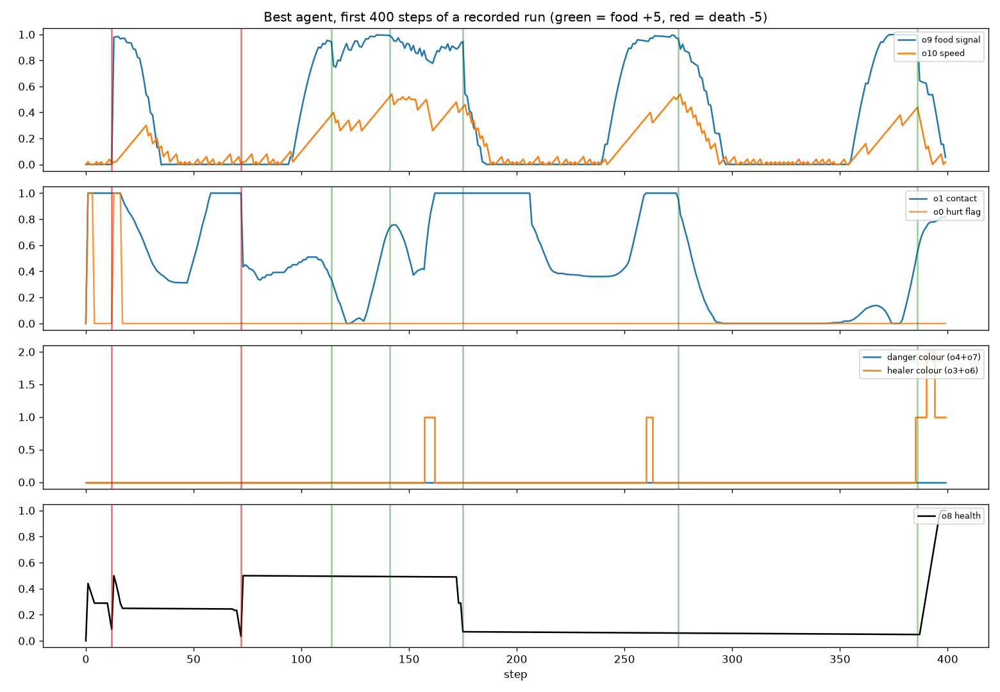

# Version 2: bigger policy, memory, "look-ahead" rewards, and crash-proof training

*16 October 2026. This answers four questions: (1) what changes now that the 128-unit limit applies only to the policy, (2) which signals announce food and danger, (3) how to optimise "a few steps away" to get food without taking damage, and (4) how to run long jobs safely on the server.*

---

## 1. The 128-unit rule applies to the policy only: what changed

| | v1 (submitted until now) | **v2** |
|---|---|---|
| **Policy** (the network that chooses actions; the 128 limit applies to it) | 1 layer × 64 = 64 units | **2 layers × 64 = 128 units** |
| **Critic** (only used during learning, to judge situations; not limited) | 1 layer × 64 | **2 layers × 256** |
| **Input** | current observation + previous action | **last 4 observations** + previous action |

**Why each change.**
- **A 2-layer policy using the full 128 units.** Two layers can represent "if A *and* B then …" rules that one layer struggles with, for example "food signal rising *and* no danger colour → go forward".
- **A much bigger critic.**
  - PPO learns from the critic's judgement of each situation (the "advantage").
  - A better judge gives cleaner learning signals, which is where most of PPO's noise comes from.
  - The critic is never used to act, so it does not count toward the limit. The submission file checks the limit at start-up (`policy hidden units 128` is printed).
- **Memory of 4 steps.**
  - A single observation says *how close* food is (obs 9) but not *whether we are getting closer*.
  - With 4 steps, "obs 9 went 0.6 → 0.7 → 0.8" means "keep going this way".
  - Measured gain: predicting damage 1 step ahead goes from AUC 0.93 to 0.95, and food 40 steps ahead from 0.87 to 0.88 (section 2).

**How v2 starts: distillation (on the GPU).**
- We did not start v2 from zero. We first trained the new policy to **copy** the current best agent on about 750,000 recorded situations, in 2 minutes on the GPU (`src/train/distill.py`).
- The copy matches the original's action probabilities to within 0.3% and makes the same most likely choice 99.7% of the time. It plays the contest world at **+40 per 1,000 steps** from minute one.
- PPO then improves it. The new, untrained critic is warmed up first (30 critic-only updates) so that its early, random judgements cannot damage the copied policy.

---

## 2. Which signals announce food and danger (and how early)

Measured on about 750,000 recorded agent-steps (`results/lead_time.txt`, script `src/explore/lead_time.py`). "Damage" means health (obs 8) drops by more than 0.01 in one step, or the agent dies.

### Getting close to food

| Signal | Far (> 100 steps) | 40 steps before | 20 | 10 | 5 | 1 | What it means |
|---|---:|---:|---:|---:|---:|---:|---|
| **obs 9** (food signal) | 0.13 | 0.30 | 0.60 | 0.80 | 0.88 | **0.91** | **rises steadily**: the main food detector |
| obs 10 (speed) | 0.11 | 0.12 | 0.20 | 0.24 | 0.28 | 0.30 | rises: you must be moving to eat |
| obs 1 (contact) | 0.56 | 0.39 | 0.36 | 0.34 | 0.34 | 0.34 | lower: food is found in open space |
| obs 4 / 7 (danger colour) | 0.07 / 0.12 | 0.03 | 0.01 | 0.00 | 0.00 | 0.00 | **off** near food |

How well each signal *alone* predicts "food within k steps" (AUC: 0.5 = useless, 1 = perfect):

| k (steps ahead) | 1 | 5 | 10 | 20 | 40 |
|---|---:|---:|---:|---:|---:|
| obs 9 | 0.94 | 0.94 | 0.93 | 0.91 | 0.82 |
| obs 10 | 0.83 | 0.83 | 0.81 | 0.76 | 0.69 |
| All 11 inputs (small network) | 0.96 | 0.95 | 0.95 | 0.93 | 0.87 |
| Last 4 observations (small network) | 0.96 | 0.96 | 0.95 | 0.94 | 0.88 |

### Getting close to damage

| Signal | Far (> 100 steps) | 40 steps before | 20 | 10 | 5 | 1 | What it means |
|---|---:|---:|---:|---:|---:|---:|---|
| **obs 1** (contact / proximity) | 0.43 | 0.53 | 0.64 | 0.79 | 0.89 | **0.96** | **rises steadily**: the earliest warning |
| **obs 4 / 7** (danger colour, left / right) | 0.02 / 0.06 | 0.07 / 0.09 | 0.13 / 0.16 | 0.18 / 0.23 | 0.24 / 0.29 | 0.22 / 0.27 | **turns on** |
| obs 10 (speed) | 0.09 | 0.14 | 0.17 | 0.18 | 0.19 | 0.21 | rises: fast = risky |
| obs 9 (food signal) | 0.22 | 0.17 | 0.18 | 0.16 | 0.14 | 0.15 | falls: danger is rarely near food |
| **obs 8** (health) | 0.49 | 0.50 | 0.50 | 0.51 | 0.52 | 0.51 → **drops** | falls *at* the damage; once falling, more damage is likely (its 3-step change predicts damage, AUC 0.31) |

| k (steps ahead) | 1 | 5 | 10 | 20 | 40 |
|---|---:|---:|---:|---:|---:|
| obs 1 alone | 0.84 | 0.84 | 0.82 | 0.78 | 0.72 |
| All 11 inputs (small network) | 0.93 | 0.92 | 0.90 | 0.86 | 0.81 |
| **Last 4 observations** (small network) | **0.95** | **0.93** | **0.92** | **0.88** | 0.83 |

**In one sentence:** *obs 9 going up means food is coming; obs 1 going up, especially with obs 4/7 on and at high speed, means damage is coming. Both are readable 10–20 steps in advance.*

---

## 3. Optimising "a few steps away": food yes, damage no

### The problem

The real reward only arrives **at** the event (+5 when eating, −5 when dying), and nothing in between. Plain RL must discover by chance which of the previous 10–20 actions led there. That is slow.

### The solution: potential-based reward shaping

We add a small extra reward **during learning only**, built from the signals above:

    potential Φ(o) = 0.5 × food signal (obs 9)
                   − 0.5 × contact (obs 1) × danger colour (max of obs 4, 7)
                   + 1.0 × health (obs 8)

    extra reward  F = 5 × (0.99 × Φ(next observation) − Φ(current observation))

Every step, the agent now gets:
- a little **plus** when the food signal rises ("you're getting closer");
- a little **minus** when it moves into a dangerous contact, or when its **health drops** (damage);
- a little **plus** when it heals.

The feedback arrives **at every step of the approach**, not only at the end.

**Why this form is safe.** This is *potential-based* shaping ([Ng, Harada & Russell, 1999](https://people.eecs.berkeley.edu/~pabbeel/cs287-fa09/readings/NgHaradaRussell-shaping-ICML1999.pdf)).
- Because F is a *difference* of potentials, its total over any path is the same whatever route the agent takes, so it cannot change which behaviour is best.
- It only makes the best behaviour **faster to find**.
- So we keep optimising the real objective (food), with damage avoidance as a learning aid, not a new goal.
- One detail: when the agent dies, F = −Φ(current), counting a dead agent's potential as 0. So respawning with fresh health is never "rewarded".

**Why these weights.** Each term moves by at most about 0.5–1 "event", while a real event is worth 1 (= 5 points), so the guidance never outweighs the real rewards. They are deliberately round numbers. The shaping term has a small negative average (about −45 per 1,000 steps); that is expected and harmless, because the critic absorbs it.

### If you want to make damage costly for real: `--damage-penalty`

The potential's health term makes damage cost something only *until it is healed*. That is what keeps it safe. If you want the agent to **really prefer not being hit**, `--damage-penalty X` adds a *permanent* cost of X × (health lost).
- This **does change the objective**: the agent may become more cautious and eat less.
- So treat it as an experiment and compare the **true** reward (food − deaths), which is what is logged as `reward_per_1000`.

### Is this "human bias"?

A little, and we say so.
- The signals were not chosen by intuition: they were **measured** (section 2).
- The shaping is **only switched on for the contest world's spaces**. For any other environment the agent stays fully generic.
- The A/B experiment below measures whether it actually helps.

---

## 4. Running long jobs safely: `scripts/rl.sh`

### Why jobs used to die, and why they won't now

Jobs started from a terminal, VS Code or Claude belong to that session and are killed when it ends. That happened to us once overnight. Now:
1. **Linger is enabled for your account** (`loginctl enable-linger` was run; `loginctl show-user $USER` shows `Linger=yes`). Your personal service manager keeps running even when you are fully logged out.
2. Every job is started as a **systemd user service** (`systemd-run --user`). It does not belong to any terminal, so closing VS Code, the SSH connection or the laptop does not affect it.
3. Training jobs have **`Restart=on-failure`**: if the program crashes, systemd restarts it 60 s later and it **resumes from its last checkpoint**.
4. The contest player has **`Restart=always`**: if it ever stops, it rejoins the world 30 s later.

### What is saved, and how disk use stays small

In `runs/<name>/`:

| File | What it is | When it is written | How many are kept |
|---|---|---|---|
| `latest.pt` | full training state: network, optimiser, normaliser, step counter | every 20,480 steps, on stop, and on server errors | 1 |
| `step_<N>.pt` | snapshot | every 20,480 steps | last 3 |
| `best_<N>.pt` | snapshots with the highest **true** reward over the last 40,960 steps | when a new top-3 appears | top 3 |
| `log.jsonl` | one line per 4,096 steps: true reward, food, deaths, damage, shaping, learning rate, speed | continuously | all (tiny) |
| `stdout.log` | console output | continuously | `prune` truncates it above 20 MB |

- Writes are **atomic** (written to a temp file, then renamed), so a crash in the middle of a save cannot corrupt a file.
- At most 20,480 steps (about 8 minutes) of experience can be lost, never the model.
- A v2 checkpoint is about 1 MB, so a run uses less than 10 MB.
- `scripts/rl.sh prune --yes` deletes leftover snapshots; add `--data-days 7` to also delete evaluation recordings older than a week.

### The commands

Run them from the project folder: `cd /Data/prakhar.tiwari/Reinforcement_Learning_Challenge`.

```bash
scripts/rl.sh status                   # what is running, last progress of every run, disk use
scripts/rl.sh logs v2                  # progress table: true reward / food / deaths / damage per 4,096 steps
scripts/rl.sh follow v2                # live output (Ctrl-C stops watching, not the job)
scripts/rl.sh stop v2                  # stop cleanly (it saves first)
scripts/rl.sh train v2                 # resume after a stop (same name = same run)
scripts/rl.sh train v2 --total-steps 1500000   # resume AND train longer
scripts/rl.sh select v2 --embed        # test the run's best checkpoints in the contest world,
                                       # embed the winner in prakhar.tiwari.py if clearly better
scripts/rl.sh contest                  # play the contest with the submission (frozen), auto-restarting
scripts/rl.sh stop contest
scripts/rl.sh prune --yes              # free disk space
```

**Rules the script enforces for you:**
- **Only one training job at a time**, because one program per token is allowed on the training server.
- **`select` refuses to run while the contest player is running**, because it would replace your playing agent. From Monday it would also count officially.

---

## 5. The plan to go higher

Current best: v1 fine-tuned, about +48 (training world) and +51 (contest world).

| # | Run | Command | Question it answers | Time |
|---|---|---|---|---|
| 1 | **v2** (running now) | `scripts/rl.sh train v2 --init runs/v2_init.pt --total-steps 800000` | does the bigger policy + memory + shaping beat +48? | ≈ 5.3 h |
| 2 | v2 without shaping | `scripts/rl.sh train v2_noshape --init runs/v2_init.pt --shaping false --total-steps 800000` | is it the shaping that helps, or the architecture? | ≈ 5.3 h |
| 3 | v2 cautious | `scripts/rl.sh train v2_safe --init runs/v2_init.pt --damage-penalty 2 --total-steps 800000` | does a real damage cost raise or lower the *true* reward? | ≈ 5.3 h |
| 4 | Pick and embed | `scripts/rl.sh select v2 --embed` (then the same for the other runs) | which checkpoint is best *in the contest world*? | ≈ 30 min |
| 5 | Continue the winner | `scripts/rl.sh train <winner> --total-steps 2000000` | does it keep improving? | as long as there is time |

Runs 1–3 must be **one after the other** (one training program per token). To compare them, look at `scripts/rl.sh logs <name>`. The column that matters is **`reward/1000` (true reward)**; also watch `damage` go down.

**Before Monday 00:00:** run step 4 for the best run, check the printed ranking, and upload `prakhar.tiwari.py` to Moodle. **During the contest:** `scripts/rl.sh contest`, then check `scripts/rl.sh follow contest` from time to time.

---

## 6. Which observations really matter? (added 16 Oct, `results/obs_importance.txt`)

**About 4–5 of the 11 inputs carry nearly all the useful information.**

| Test | Result |
|---|---|
| Predict **food** within 10 steps (AUC), adding inputs one by one, best first | o9 alone **0.935** → +o10 0.948 → +o8 0.951 → all 11: 0.954 |
| Predict **damage** within 10 steps | o1 alone **0.853** → +o10 0.886 → +o8 0.900 → +o7 0.905 → all 11: 0.915 |
| Remove one input (AUC drop) | only o9 (food −0.093), o1 (damage −0.058), o10 (−0.012 / −0.016) and o8 (−0.010) matter; removing any other costs ≤ 0.004 |
| How much **our trained policy** uses each input (change of its decisions when the input is scrambled) | o9 28%, o10 28%, o7 23%, o1 10%, o8 5%: **94% of its decisions**; o0, o2, o5 below 1% |

**We still feed all 11 to the agent.** They cost nothing, and the rare ones (healer colour o3/o6) matter rarely but crucially (healing). The challenge also requires a generic agent that does not hand-pick inputs.

## 7. What happens after damage? (`results/after_damage.txt`, `results/episode_best_agent.csv`)

- **A hit removes about 0.10 health** (median; hits of 0.05–0.10 per step, often several in a row).
- **Health does not come back on its own.** In only 15% of cases is it back to its pre-hit level within 40 steps. Only a **healer** (colour o3/o6) restores it, and fast: in the recorded run, from 0.05 to 1.0 in about 10 steps.
- **A first hit is very dangerous:** 49% of agents die within 40 steps of it, because the next hits find them with less health.
- Apart from health, the agent's inputs change only briefly. o0 (a rare flag) turns on during some hits, especially right after respawning. Contact (o1) stays high, then falls as the agent moves away.
- **There is no hidden "injured mode": the only lasting trace of damage is lower health (o8).** So with low health the right move is to find a healer, which the v2 shaping (health term) encourages.
- **After death (−5):** the agent respawns with health 0.5, speed 0, no colours. Sometimes it respawns right into contact and takes hits immediately (steps 13–15 of the recorded run).
- **Correction of an earlier label:** o1 ("contact") is at 1.0 for long stretches *without* damage (the timeline below, steps 160–205). It means "touching / very close to *something*", not only something harmful. The harmful cases are signalled by o4/o7 (danger colour) or by health dropping.




---

## 8. Outcome (17 Oct 2026)

- **PPO v2** (policy 64+64, critic 256+256, 4-observation history, shaping), copied from the best v1 policy and trained 89,396 steps with lr 3e-4 and entropy bonus 0.01: **plateau at ≈ +36 per 1,000** (training world), below its starting point (+44 to +46). Stopped. Likely cause: learning rate and entropy bonus too high for an already-trained policy. Saved in `runs/v2/` (resumable).
- **"Best move" table** (exploration of 20 moves × 70,600 decision points, `src/train/explore_moves.py`, `move_values.py`, `move_policy.py`): it clearly identifies `[0,0]` when o1 > 0.9 with o4/o7 = 1, and `[0,0]` × 4 when o8 < 0.3 with o3/o6 = 1. But **as a policy it failed** (−2.5 to +11.7 vs base +42 to +52), because its estimates are wrong in the states it reaches itself (covariate shift).
- **Double DQN** (`src/train/ddqn.py`), with the exploration data in its replay buffer: **+141 per 1,000 in the contest world**, the new submission. See [DDQN.md](DDQN.md) and [STATUS.md](STATUS.md).
